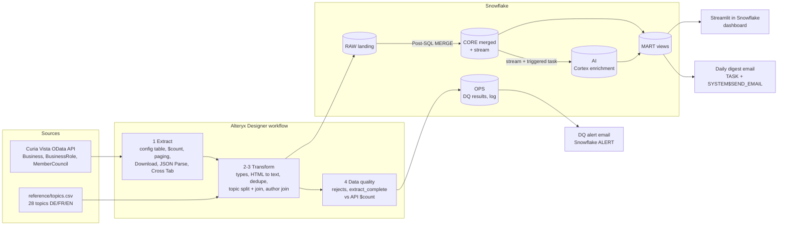

# Swiss Parliament data pipeline: Alteryx → Snowflake → Cortex AI

This pipeline pulls every item submitted to the Swiss Parliament since 1 January 2025 (motions, interpellations, postulates, Federal Council bills, about 6,700 items) from the official open-data API. **Alteryx** cleans and checks the data and loads it into **Snowflake**. **Snowflake Cortex AI** then translates it to English, summarises it, classifies it and flags the items about AI and digitalisation. A Streamlit dashboard and two automated emails sit on top.

I am building it to learn Alteryx and Snowflake hands-on, on real public data, covering what a data engineering role on this stack does day to day: connect a new source, transform it, load it, add data quality, automate notifications, try Cortex AI features, and document the result.

## Status

| Part | State |
|---|---|
| Python reference check against the live API | **Run** (6 Nov 2026). The counts and data issues below come from this run. |
| Alteryx workflow (`.yxmd`) | **Runs in Alteryx Designer 2026.3** (7 Nov 2026): about 9 minutes, all API data into Snowflake. Snowflake matches the Python check on every table. What the first runs found and how it was fixed: [docs/PIPELINE.md](docs/PIPELINE.md#what-the-first-real-runs-taught-me-designer-20263-7-nov-2026) |
| Snowflake objects, MERGE procedures, dashboard views (00–03, 05), Streamlit app (07) | **Deployed** on a Snowflake trial (AWS eu-north-1) |
| Cortex evaluation (04) | **Run** (9 Nov 2026): 300 items, 4 AI variants + baseline, 1.59 AI credits. Results: [docs/CORTEX_EVAL.md](docs/CORTEX_EVAL.md) |
| Cortex enrichment (03) | **Run on all 6,690 items** (9 Nov 2026): 27 minutes, about 6.5 AI credits. 573 items flagged as AI / data / digital. The triggered task is on, so new or changed items are enriched after each Alteryx load. Details: [docs/CORTEX_EVAL.md](docs/CORTEX_EVAL.md#full-backfill-9-nov-2026) |
| Incremental run, end to end | **Run** (10 Nov 2026): the Alteryx workflow again in Designer, 13 min 47 s, 0 errors and 0 warnings; Snowflake matches the Python check on all five counts. 76 items had changed since 7 Nov: the MERGE updated them, and the triggered task re-enriched the 70 whose text had changed. The other 6 changes (status etc.) did not trigger new AI calls. |
| Emails (06) | Written, not yet run |

This section is updated as each part runs.



## What each part does

| Step | Where | What happens |
|---|---|---|
| Extract | Alteryx | A config Text Input lists the three API entities (filter, fields, page size). For each one the workflow asks the API for `$count`, generates one row per page (Generate Rows), downloads every page as JSON, flattens it (JSON Parse) and rebuilds one record per row (Cross Tab). Adding a new source = one more config row. |
| Transform | Alteryx | Types and renames, HTML → plain text, OData `/Date(ms)/` → dates, dedupe on ID, topic list split to rows and joined to a reference CSV (DE → tag id + English), authors joined to members (party, canton). |
| Data quality | Alteryx → `OPS` | Every rejected row goes to `OPS.DQ_REJECTS` with a reason. `extract_complete` checks records received against the API's own `$count` per entity. Unknown topics (reference CSV out of date) are a `FAIL`; bad source rows are a `WARN`. |
| Load | Alteryx → `RAW` → `CORE` | Each Output Data tool empties and refills a landing table over ODBC, then its *Post Create SQL* calls a MERGE procedure. MERGE is hash-based and idempotent: re-running a load changes nothing. |
| AI enrichment | Snowflake Cortex | A stream on `CORE.BUSINESS` feeds a triggered task. Only new or changed items (by content hash) reach `AI_TRANSLATE` (title DE → EN), `AI_COMPLETE` (one-sentence English summary, and topics with a JSON schema of the 28 official topics, `AI_CLASSIFY` as fallback) and `AI_FILTER` (is it about AI, data, digitalisation or cyber?). Model: llama3.1-70b, inference kept inside the EU. |
| Evaluation | Snowflake Cortex | AI topic tags vs the topics Parliament staff assign by hand, on 300 items, in 4 variants plus a no-AI baseline. The general model with a JSON schema scored best (F1 0.653 vs 0.175 baseline) at about 1/12 of `AI_CLASSIFY`'s cost per item, so the enrichment uses it: [docs/CORTEX_EVAL.md](docs/CORTEX_EVAL.md). |
| Serve | Snowflake | `MART` views, a Streamlit in Snowflake dashboard, an hourly ALERT that emails when a DQ check fails, and a weekday 07:00 digest email of new AI/digital items with English summaries. |

## Real data issues found so far

Found by the Python reference check ([tools/reference_check.py](tools/reference_check.py)) against the live API on 6 Nov 2026, and handled the same way by the Alteryx workflow in its runs on 7 Nov 2026 (`OPS.DQ_RESULTS`: 3 × `extract_complete` PASS, 2 × WARN):

- **The API firewall rejects `Accept: application/json`** on the `$count` endpoint (it answers `text/plain`). The Download tools are set up to send no Accept header and ask for JSON with `$format=json`.
- **A real duplicate in the source.** Business 25.2013 is returned twice for the same ID and language. The workflow dedupes it (`Unique` tool) and logs it as a `WARN`.
- **3 items with an empty title** (25.444, 26.8043, 26.8044). The workflow's DQ rule rejects and logs them.
- Records received matched the API's `$count` for all three entities: 6,694 business items, 6,422 author rows, 272 members (since 2025-01-01).

## Repository layout

```
alteryx/
  build_workflow.py          generates the workflow (every tool setting reviewable as code)
  parliament_pipeline.yxmd   the Alteryx Designer workflow
reference/topics.csv         28 official topics, DE/FR/EN + short descriptions
snowflake/
  00_bootstrap_admin.sql     once, as ACCOUNTADMIN: warehouse, cost guard, role, email integration, key-pair user
  01_objects.sql             schemas RAW/CORE/AI/MART/OPS, tables, stream
  02_merge_procedures.sql    RAW -> CORE MERGE procedures (called by Alteryx Post-SQL)
  03_cortex_enrichment.sql   Cortex enrichment procedure + triggered task
  04_cortex_eval.sql         AI_CLASSIFY evaluation (generated from topics.csv)
  05_marts.sql               dashboard views
  06_notifications.sql       DQ alert + daily digest email
  07_streamlit.sql           Streamlit in Snowflake app
  streamlit/streamlit_app.py
tools/
  reference_check.py         Python twin of the workflow = test oracle for the Alteryx run
  sf.py                      run SQL files / status checks with key-pair auth
  gen_eval_sql.py            renders 04_cortex_eval.sql from topics.csv
docs/
  SETUP.md                   from zero to a running pipeline
  PIPELINE.md                tool-by-tool walkthrough, design decisions, what I would do next
  CORTEX_EVAL.md             evaluation results: quality and cost per variant
```

## Run it

Full steps are in [docs/SETUP.md](docs/SETUP.md). In short:

1. Snowflake trial: run `00_bootstrap_admin.sql` once as ACCOUNTADMIN, then `python tools/sf.py run snowflake/01_objects.sql … 03_cortex_enrichment.sql`.
2. Windows ODBC DSN `snowflake_parliament` (Snowflake driver, key-pair auth).
3. Open `alteryx/parliament_pipeline.yxmd` in Alteryx Designer and run it.
4. `04_cortex_eval.sql`, `CALL AI.ENRICH(10000)`, then `05`–`07`.

Data: [Swiss Parliament open data](https://www.parlament.ch/en/services/open-data-webservices) (Curia Vista web service), public.
